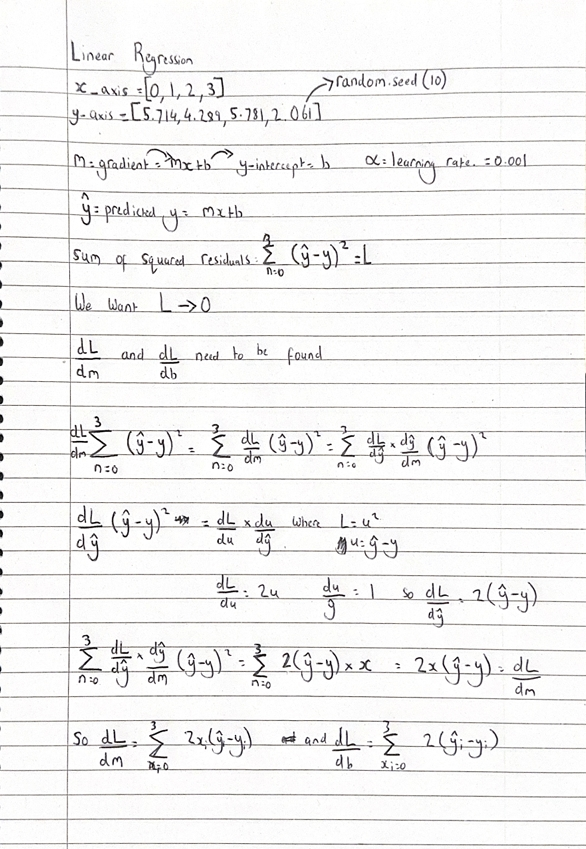

# Linear-Regression
### Overview:
A simple machine learning model coded in Python.  
Improvements between models is referenced below.

## LinRegV1

This is the first iteration of the Linear Regression Model.  
It is also the simplest. 

### Calculations for Gradient Descent

I have defined my derivatives (dL/dm and dL/db) to be the following:

LinRegV1 uses procedural programming constructs such as functions and global variables in order to calculate the line of best fit.
We use the Sum of Squared Residuals (SSR) loss function and stochastic gradient descent in order to minimise the loss function and find the regression line.

Main Problems: The use of global variables and procedural programming which weakens code safety.

## LinRegV2

This is the second iteration of the Linear Regression model and builds on LinRegV1. 
Two classes were made: Linear_Regression() and Regression_Graph() to ensure the Single Responsibility Principle is maintained.

Main Changes:
1) Moving to Object Oriented Paradigm  
<t> Moving to OOP removed the need for global variables and ensured everything was self contained 
2) Moving from SSR to Mean Squared Error  
<t> Prevents incredibly high loss values as number of obeservations increases

Main Problems: 
1) Using loops instead of numpy functions for array operations. 
2) The loss function still grows very quickly

## LinReg3

Third iteration of the Linear Regression model. 
Made small changes by replacing loops with numpy functions.

Main Problem:
1) The derivative values grow very quickly with large number of obdervations